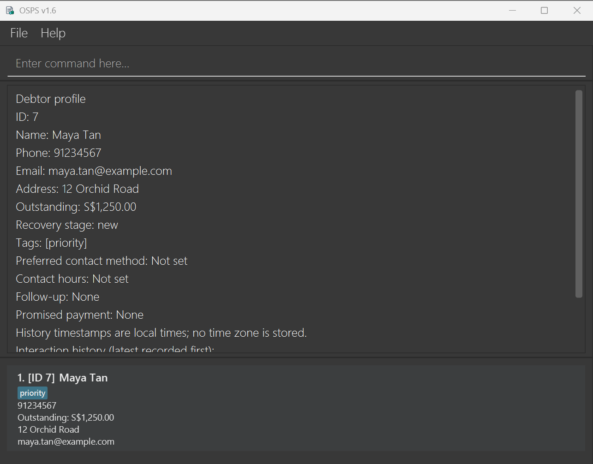

# Orchestration and Scheduling of Payment Scheme (OSPS)

OSPS is a desktop application for debt recovery agents to manage debtor contact details, outstanding balances,
interaction histories, follow-ups, and recovery stages. It combines a graphical interface with keyboard-driven
commands for fast case management.

**Build identity:** this source and its guides describe the **v1.6 candidate**. Candidate source commits, JAR
SHA-256 checksums and verification results are tracked in [#221](https://github.com/AY2627S1-CS2103T-F08-1/tp/issues/221).
Follow the [candidate setup instructions](https://ay2627s1-cs2103t-f08-1.github.io/tp/UserGuide.html#quick-start)
and use the recorded checksum to identify the exact build being tested. A v1.6 window title alone does not identify
the source commit. This notice does not announce a published v1.6 release.

The published [v1.5 release](https://github.com/AY2627S1-CS2103T-F08-1/tp/releases/tag/v1.5) remains separate:
use its recorded artifact checksum and [matching User Guide](https://github.com/AY2627S1-CS2103T-F08-1/tp/blob/e5c7066959164fb720843a8b06c6d9f4080b6089/docs/UserGuide.md),
rather than these candidate instructions. Check [GitHub Releases](https://github.com/AY2627S1-CS2103T-F08-1/tp/releases)
for published downloads and their source/artifact identity.

The v1.6 candidate supports these connected workflows:

* Capture and maintain debtor profiles, contact preferences, and non-negative outstanding amounts.
* Find, filter, and sort the current worklist by name, phone, balance, recovery stage, follow-up date, or contact window.
* Record interaction outcomes, promised-payment dates, follow-ups, and recovery-stage changes with persistence.
* Review complete profiles, workload summaries, and due follow-ups, or export one debtor's profile for authorised use.
* Preview risky edits or deletions and recover saved changes with session undo and redo.

OSPS deliberately distinguishes a debtor's stable persistent ID from the one-based index of the currently displayed
worklist. Commands that contain `--id` use the persistent ID; `edit`, `delete`, and their previews use the visible
displayed index. The User Guide explains this distinction with examples and a visual reference.

For setup, exact command syntax, and the distinction between debtor IDs and displayed indexes, see the
[User Guide](https://ay2627s1-cs2103t-f08-1.github.io/tp/UserGuide.html). Developers can refer to the
[Developer Guide](https://ay2627s1-cs2103t-f08-1.github.io/tp/DeveloperGuide.html).

OSPS is based on the AddressBook-Level3 project created by the
[SE-EDU initiative](https://se-education.org).
