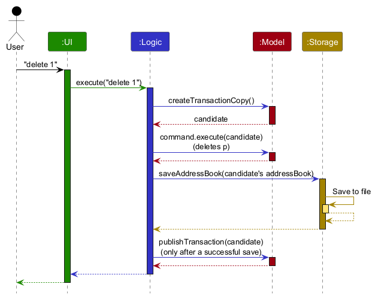
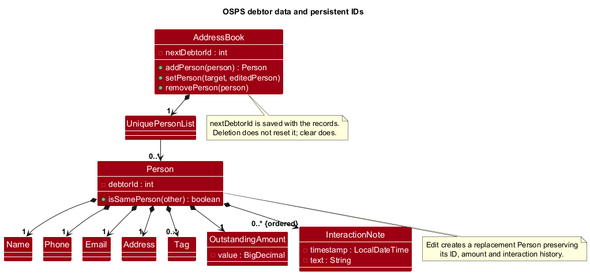
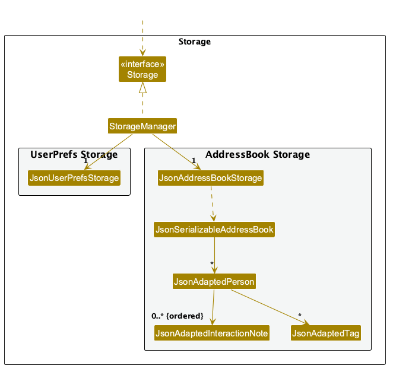

* Table of Contents
{:toc}

--------------------------------------------------------------------------------------------------------------------

## **Acknowledgements**

* OSPS is based on [AddressBook-Level3](https://github.com/se-edu/addressbook-level3) by the
  [SE-EDU initiative](https://se-education.org). The original project structure, documentation layout, and selected
  diagrams were adapted for OSPS.
* The project uses [JavaFX](https://openjfx.io/) for its graphical interface,
  [Jackson](https://github.com/FasterXML/jackson) for JSON persistence, and
  [JUnit 5](https://junit.org/junit5/) for automated testing.

--------------------------------------------------------------------------------------------------------------------

## **Setting up, getting started**

Refer to the guide [_Setting up and getting started_](SettingUp.md).

--------------------------------------------------------------------------------------------------------------------

## **Design**

:bulb: **Tip:** The `.puml` files used to create diagrams are in `docs/diagrams`. Refer to the [_PlantUML Tutorial_ at se-edu/guides](https://se-education.org/guides/tutorials/plantUml.html) to learn how to create and edit diagrams.

### Architecture

The ***Architecture Diagram*** given above explains the high-level design of the App.

The following provides a quick overview of the main components and their interactions.

**Main components of the architecture**

**`Main`** (consisting of classes [`Main`](https://github.com/AY2627S1-CS2103T-F08-1/tp/blob/master/src/main/java/seedu/address/Main.java) and [`MainApp`](https://github.com/AY2627S1-CS2103T-F08-1/tp/blob/master/src/main/java/seedu/address/MainApp.java)) is in charge of the app launch and shut down.
* At app launch, it initializes the other components in the correct sequence, and connects them up with each other.
* At shut down, it shuts down the other components and invokes cleanup methods where necessary.

The bulk of the app's work is done by the following four components:

* [**`UI`**](#ui-component): The UI of the App.
* [**`Logic`**](#logic-component): The command executor.
* [**`Model`**](#model-component): Holds the data of the App in memory.
* [**`Storage`**](#storage-component): Reads data from, and writes data to, the hard disk.

[**`Commons`**](#common-classes) represents a collection of classes used by multiple other components.

**How the architecture components interact with each other**

The *Sequence Diagram* below shows how the components interact with each other for the scenario where the user issues the command `delete 1`.

Each of the four main components (also shown in the diagram above),

* defines its *API* in an `interface` with the same name as the Component.
* provides its functionality through a concrete `{Component Name}Manager` class that implements the corresponding API interface.

For example, the `Logic` component defines its API in `Logic.java` and implements it in `LogicManager.java`. Other components interact with a component through its interface rather than its concrete class, preventing them from coupling to that component's implementation, as illustrated in the following partial class diagram.

The sections below give more details of each component.

### UI component

The **API** of this component is specified in [`Ui.java`](https://github.com/AY2627S1-CS2103T-F08-1/tp/blob/master/src/main/java/seedu/address/ui/Ui.java)

The UI consists of a `MainWindow` and its parts, such as `CommandBox`, `ResultDisplay`, `PersonListPanel`, and `StatusBarFooter`. All of these, including `MainWindow`, inherit from the abstract `UiPart` class, which captures common behavior among classes that represent visible GUI parts.

The `UI` component uses the JavaFX UI framework. The layouts of these UI parts are defined in matching `.fxml` files in `src/main/resources/view`. For example, [`MainWindow.fxml`](https://github.com/AY2627S1-CS2103T-F08-1/tp/blob/master/src/main/resources/view/MainWindow.fxml) specifies the layout of [`MainWindow`](https://github.com/AY2627S1-CS2103T-F08-1/tp/blob/master/src/main/java/seedu/address/ui/MainWindow.java).

The `UI` component,

* executes user commands using the `Logic` component.
* listens for changes to `Model` data so that the UI can be updated with the modified data.
* keeps a reference to the `Logic` component, because the `UI` relies on the `Logic` to execute commands.
* depends on some classes in the `Model` component because it displays `Person` objects from the model.

### Logic component

**API** : [`Logic.java`](https://github.com/AY2627S1-CS2103T-F08-1/tp/blob/master/src/main/java/seedu/address/logic/Logic.java)

Here's a (partial) class diagram of the `Logic` component:

The sequence diagram below illustrates the interactions within the `Logic` component, taking `execute("delete 1")` API call as an example.

:information_source: **Note:** The lifeline for `DeleteCommandParser` should end at the destroy marker (X), but due to a limitation of PlantUML, it continues to the end of the diagram.

How the `Logic` component works:

1. When `Logic` is called upon to execute a command, the command is passed to an `AddressBookParser` object, which in turn creates a parser that matches the command (e.g., `DeleteCommandParser`) and uses it to parse the command.
1. This results in a `Command` object (more precisely, an object of one of its subclasses e.g., `DeleteCommand`) which is executed by the `LogicManager`.
1. The command can communicate with the `Model` when it is executed (e.g. to delete a person). 
   Note that although this is shown as a single step in the diagram above for simplicity, the code can require several interactions between the command object and the `Model` to complete the operation.
1. The result of the command execution is encapsulated as a `CommandResult` object which is returned from `Logic`.

#### Delete command implementation

`delete INDEX` uses a one-based index into the debtor list currently shown by the model. `ModelManager#getFilteredPersonList()` returns that filtered list sorted by persistent debtor ID, so a preceding `find` affects which debtor `delete 1` selects. The index is not a debtor ID and is checked against the displayed list at execution time.

`DeleteCommandParser` accepts a positive decimal integer and strips leading zeroes. Empty input, non-digits, zero, and negative values produce an invalid-command-format error with the command usage. The parser keeps the normalized index as decimal text, so very large inputs do not overflow an integer during parsing. `DeleteCommand` checks it against the current displayed-list size using decimal length and lexical comparison before converting an in-range value to an integer. An index outside the list produces an actionable range error; when the list is empty, the error suggests running `list` or adjusting the `find` query. For an index longer than 100 digits, feedback shows its first 20 digits and total digit count. These parse and range failures do not change the model or trigger a save.

For an in-range index, `DeleteCommand` removes the selected `Person` through `Model#deletePerson`. For persistence-bound commands, `LogicManager` executes against an isolated copy of the model that retains the active filter, saves the candidate, and only then publishes it to the live observable model. The success message includes the deleted debtor's ID, name, phone, email, address, outstanding amount, and tags. A storage failure leaves the live model and displayed list unchanged.

Interaction notes, follow-up state/history, and contact preferences are part of the `Person` record. Deleting a debtor therefore removes the profile and all related state from the active address book and, after a successful save, from persisted data. `show --id ID` can display profiles only for active debtors, so it reports that the debtor may have been deleted after removal. The model keeps up to 100 in-session address-book snapshots for undo/redo; snapshots include `nextDebtorId`, while restore preserves the allocator's high-water mark so IDs are never reused.

Here are the other classes in `Logic` (omitted from the class diagram above) that are used for parsing a user command:

How the parsing works:
* When called upon to parse a user command, the `AddressBookParser` class creates an `XYZCommandParser` (`XYZ` is a placeholder for the specific command name, e.g., `AddCommandParser`). The parser uses the other classes shown above to parse the user command and create an `XYZCommand` object (e.g., `AddCommand`). The `AddressBookParser` returns that object as a `Command` object.
* All `XYZCommandParser` classes, such as `AddCommandParser` and `DeleteCommandParser`, implement the `Parser` interface so they can be treated similarly where appropriate, for example during testing.

### Model component

The OSPS debtor model extends the original contact model with persistent IDs, outstanding amounts and
interaction notes. The following diagram shows the stored debtor data:

`AddressBook` saves `nextDebtorId` alongside its records so deleting a debtor, including the final debtor,
does not cause ID reuse after restart. `clear` deliberately resets allocation. Missing IDs in legacy records
are allocated on load.

`EditCommand` creates a replacement immutable `Person`, preserving its ID, outstanding amount, notes, contact
preferences, pending follow-up date, follow-up history, and recovery
stage. A recovery stage is one of `new`, `contacted`, `negotiating`, `disputed`, `broken-promise`, or `settled`.
`stage --id ID --value STAGE` selects a debtor by persistent ID, so it still targets the correct debtor while the list
is filtered. Old JSON omits the optional stage and loads as `new`.
Duplicate checks compare exact phone/email values against all other active debtors, including filtered-out
records. Email matching is currently case-sensitive; phone country codes are not normalised.

**API** : [`Model.java`](https://github.com/AY2627S1-CS2103T-F08-1/tp/blob/master/src/main/java/seedu/address/model/Model.java)

The `Model` component,

* stores the address book data i.e., all `Person` objects (which are contained in a `UniquePersonList` object).
* stores the `Person` objects selected by the current filter, such as search results, in a separate _filtered_ list. It exposes this list as an unmodifiable `ObservableList<Person>` that the UI can observe and bind to, so the UI updates when the list changes.
* stores a `UserPrefs` object that represents the user’s preferences (currently, just the GUI settings). This is exposed to the outside as a `ReadOnlyUserPrefs` object.
* does not depend on any of the other three components (as the `Model` represents data entities of the domain, they should make sense on their own without depending on other components)

:information_source: **Note:** The alternative, arguably more object-oriented, design below keeps a unique list of tags in `AddressBook`, and each `Person` references tags from that list. This lets `AddressBook` maintain one `Tag` object per unique tag instead of each `Person` holding its own `Tag` objects. 

### Storage component

**API** : [`Storage.java`](https://github.com/AY2627S1-CS2103T-F08-1/tp/blob/master/src/main/java/seedu/address/storage/Storage.java)

The `Storage` component,
* can save both address book data and user preference data in JSON format, and read them back into corresponding objects.
* is implemented by `StorageManager`, which delegates the actual JSON file access to `JsonAddressBookStorage` and `JsonUserPrefsStorage` (one class per data file).
* depends on some classes in the `Model` component (because the `Storage` component's job is to save/retrieve objects that belong to the `Model`)
* stores each debtor's ordered interaction history through `JsonAdaptedInteractionNote`; invalid entries, including
  JSON `null` notes and unrecognised contact outcomes, are reported as data-loading errors.

Interaction notes retain their insertion order in JSON, including identical text and timestamps. Profile formatting
reverses a copy of the insertion-ordered list before applying the ordered stream's stable sort by descending
timestamp. Stability preserves reverse insertion order for equal timestamps. Editing a debtor preserves the full
history. `NoteHistoryWorkflowTest` verifies these behaviours together across editing, JSON reload and `show`.

Each interaction note can also store a `ContactOutcome`: `reached`, `callback-requested`, `unreachable`, or
`payment-promised`. The JSON `outcome` field is nullable so files created before this feature remain loadable; a
missing value becomes an `unspecified` outcome when displayed. New non-null values outside the supported set fail
loading instead of silently losing information. The note parser accepts `--outcome` only before `--text`, which keeps
option-like words in the note body as literal text. Contact outcomes are metadata and do not alter outstanding amounts.

`LogicManager` runs each persistence-bound command against a candidate model that copies the current filter. It saves
the candidate before publishing its records and view to the live model. If saving fails, the live records, next-ID
state, and displayed view are unchanged; the user must re-enter the command after resolving the problem. `exit` does
not retry a failed command.

`JsonAddressBookStorage` serializes the complete JSON before writing, writes it to a temporary sibling file, forces
the file channel, then replaces the destination with `ATOMIC_MOVE` and `REPLACE_EXISTING`. If the file system does
not support an atomic move, saving fails closed and the temporary file is removed best-effort. No non-atomic
overwrite fallback is attempted. This protects the previous file from ordinary write and replacement failures; it
does not promise crash durability or recovery from power loss. The storage test injects unsupported atomic move, and
logic tests inject save exceptions to check that memory, the active filtered view, next-ID state, and existing disk
bytes remain unchanged.

### Follow-up command and history

`AddressBookParser` routes `followup` to `FollowUpCommandParser`. The parser accepts one positive debtor ID and exactly
one operation: a calendar-valid `--date YYYY-MM-DD`, `--clear`, or `--done`. `FollowUpCommand` finds the debtor by its
persistent ID, independent of the current list filter. A date command records `SCHEDULED` when no date is pending and
`RESCHEDULED` otherwise. Clear and done require a pending date; they remove it and append a `CLEARED` or `COMPLETED`
event containing the date that was removed. Scheduling after either operation starts a new `SCHEDULED` event. Invalid
options, dates, IDs, and operations without a pending date are rejected before the model changes.

`Person` stores the pending date as `Optional<LocalDate>` and an immutable insertion-ordered list of
`FollowUpEvent` values. Each event records an ISO local date-time timestamp, its action, and the previous and resulting
ISO dates.
JSON stores the pending date in optional `followUpDate` and the event list in `followUpHistory`, with each entry shaped
as `{ "timestamp": "YYYY-MM-DDTHH:mm:ss", "action": "SCHEDULED|RESCHEDULED|CLEARED|COMPLETED", "previousDate": null|"YYYY-MM-DD", "newDate": null|"YYYY-MM-DD" }`.
The loader also accepts the earlier single `date` field and migrates it according to the preceding follow-up state.
The timestamp comes from the system-default clock and has no stored zone or offset. Events remain in insertion order
in JSON. `show` sorts by timestamp ascending with a stable sort, so equal timestamps retain insertion order.

Older address-book JSON files that omit `followUpDate` and `followUpHistory` load with no pending date and an empty
history. Invalid dates, timestamps, actions, or event entries are reported as data-loading errors. A valid follow-up
command runs inside the same isolated save transaction as other persistence-bound commands. A save failure leaves the
live model, its undo/redo history, and the previous file bytes unchanged; the user can correct the storage problem and
run the command again.

### Contact validation and preference recovery

`Email.isValidEmail` scans the local part and domain labels iteratively. Validation uses linear time and constant
auxiliary space, avoiding recursive regex matching during both commands and `JsonAdaptedPerson` reloads.
The existing local-part character rules remain; domain labels allow consecutive internal hyphens, including ASCII
Punycode prefixes. This is OSPS syntax validation, not a check that a mailbox or domain exists. No new length limit
is imposed, so previously accepted long records can still reload.

`Address` uses Unicode whitespace matching when rejecting an initial space, including EM SPACE and non-breaking
spaces. `JsonUserPrefsStorage` replaces an explicitly null `guiSettings` field with default settings before returning
preferences, preserving the non-null invariant required by `UserPrefs` and `ModelManager`.

### Common classes

Classes used by multiple components are in the `seedu.address.commons` package.

--------------------------------------------------------------------------------------------------------------------

## **Implementation**

This section describes some noteworthy details on how certain features are implemented.

### Privacy-preserving logging

OSPS stores debtor records, so its logs must not become a second, less protected copy of those records. The logging
invariant is:

> Personal data from a debtor record or command must never be written to a log. This includes names, phone numbers,
> email addresses, postal addresses, and interaction-note text.

The invariant applies to successful commands, rejected commands, startup, and error handling. In particular, developers
must not log raw command text, command arguments, `Person` objects, the full address book, or user-facing command
feedback, as each can contain personal data.

OSPS retains useful operational diagnostics without recording command content as follows:

* `CommandLogFormatter` maps input to an allowlisted command category, such as `add`, `find`, or `note`. Arguments are
  discarded. Blank input becomes `<empty>`, while an unrecognised first token becomes `<unknown>` instead of being
  repeated in the log, because even that token could contain personal data.
* `LogicManager` records only the safe command category when execution starts.
* `MainWindow` records the command category and whether execution succeeded. A failure additionally records the
  exception class, but not the exception message or command text.
* `ModelManager` records only aggregate metadata (the number of address-book entries) during initialization, rather than
  serializing the address book or its people.

This gives developers enough information to identify the command path, outcome, and failure category. Detailed values
needed to reproduce a defect should be supplied through a controlled test case, not recovered from a user's log file.
`CommandLoggingTest` enforces the boundary with sentinel personal values and checks that none appear in captured logic,
parser, or model log records.

#### Design considerations

**Aspect: Amount of command information retained:**

* **Alternative 1 (current choice): Log an allowlisted command category and aggregate metadata.**
  * Pros: Preserves useful execution context while preventing command arguments, result feedback, and model content from
    leaking into logs.
  * Cons: A log cannot reconstruct the exact input that caused a failure.
* **Alternative 2: Log raw input after pattern-based redaction.**
  * Pros: Retains more detail for debugging.
  * Cons: Free-form addresses and notes, malformed commands, and future prefixes make complete redaction unreliable. A
    missed pattern can expose personal data, so this alternative was rejected.

### Finding and listing debtors

The `find` command filters the active debtors using one or more search keywords. Each keyword matches either a
case-insensitive literal substring in the debtor's name or the debtor's complete phone number. Matching uses `OR`
semantics,
so a debtor is included when any keyword matches either field.

`FindCommandParser` normalises surrounding and repeated whitespace before constructing a
`NameContainsKeywordsPredicate`. When `FindCommand` executes, it passes that predicate and the default ID comparator
to `ModelManager#updatePersonView`. The JavaFX `FilteredList` applies the predicate to the active debtors, while the
existing `SortedList` returned by `ModelManager#getFilteredPersonList` keeps the displayed matches in ascending
persistent debtor ID order. The second half of the diagram shows how `list` restores all active debtors by replacing
the search predicate with `Model#PREDICATE_SHOW_ALL_PERSONS` and restoring the same default comparator.

The `sort` command changes only the comparator of that `SortedList`, so the current `FilteredList` predicate and the
backing `AddressBook` remain unchanged. `SortCommandParser` requires one `--by` option (`id`, `name`, or `amount`) and
accepts an optional `--order` option (`asc` or `desc`). It rejects duplicate or unknown options and extra values before
executing the command. The parser converts case-insensitive tokens to `PersonSort.Field` and `PersonSort.Direction`;
the command asks `PersonSort` for the corresponding comparator and passes it to
`ModelManager#updateSortedPersonList`.

`PersonSort` compares names with `Locale.ROOT` case normalisation and outstanding amounts using their stored
`BigDecimal` values. Name and amount comparators append persistent ID ascending as a deterministic final tie-breaker.
Only the primary comparator is reversed for descending sorts, so equal names or amounts still appear by ascending ID.
An ID sort applies the requested direction directly. The observable `SortedList` re-evaluates its order when a
displayed person is edited, added, or deleted; index-based commands therefore operate on exactly the order visible in
the UI. `find`, `list`, and a successful `add` deliberately restore the default ID-ascending view, while edit/delete
preserve the current predicate and comparator.

#### Design considerations

* **Exact phone matching instead of substring matching:** Names use case-insensitive literal-substring matching because
  users commonly remember only one part of a name. The query is not interpreted as a regular expression, so punctuation
  in a real name is safe and predictable. Phone numbers use exact matching because a partial number can match several
  debtors and make the result ambiguous. Phone values are already validated and stored as digit-only strings, so no
  additional punctuation or whitespace normalisation is needed at search time. This keeps phone searches predictable:
  the user must enter the complete stored number.
* **One model-level `SortedList` instead of sorting inside each command:** `ModelManager` wraps its `FilteredList` in a
  single `SortedList`. `find`, `list`, `sort`, and every UI observer of `getFilteredPersonList` therefore share the
  same order without copying or mutating persistent records. The list stays ordered when the predicate or backing data
  changes, rather than only when a particular command happens to run.
* **Deterministic tie-breaking instead of relying on insertion order:** Equal normalized names or numeric amounts are
  ordered by persistent ID ascending. This makes displayed indexes reproducible after edits and restarts. Reversing
  only the selected primary comparator avoids the surprising result where two equal amounts swap relative order when
  the user changes from ascending to descending.
* **Wrapping card content instead of truncating it:** Debtor-card labels for names, contact details, addresses, and
  outstanding amounts allow text wrapping, while tags are placed in a `FlowPane`. This preserves identifying and
  financial information when the window is narrow or a value is long. The persistent ID is kept at its preferred
  width so that wrapping the adjacent name does not obscure which debtor the card represents.

### Filtering by outstanding amount

`list-amount` is a read-only view command. `ListAmountCommandParser` tokenizes the optional `min/` and `max/` bounds,
reuses `ParserUtil#parseOutstandingAmount`, rejects duplicate or missing bounds, and constructs an
`OutstandingAmountRange`. The range owns the invariant that at least one bound exists and that the minimum does not
exceed the maximum. It compares the underlying `BigDecimal` values, avoiding rounding and string-comparison errors.

`ListAmountCommand` wraps the range in an `OutstandingAmountInRangePredicate` and supplies it to the same
`ModelManager#updateFilteredPersonList` path used by `find`. Consequently, the existing observable `FilteredList` and
ID-ordered `SortedList` update the cards without reordering persistent data. A later `list` command restores the
show-all predicate. Because the command overrides `shouldSaveAddressBook` with `false`, changing the view does not
write JSON or retry a previously failed write.

#### Design considerations

* **Inclusive instead of exclusive bounds:** Collection bands normally include the exact threshold stated by a user.
  Inclusive comparison also makes a single-value range such as `min/500 max/500` useful and unsurprising.
* **Reuse the amount value object instead of parsing raw decimals in the command:** This keeps accepted currency syntax
  consistent with `add` and `edit`, prevents negative amounts, and centralises precision validation.
* **Keep filtering session-only instead of persisting it:** The command represents a temporary work view rather than
  debtor data. Restarts and `list` therefore return to the complete ID-ordered list.

### Undo/redo feature

`ModelManager` keeps a bounded list of up to 100 `AddressBook` snapshots and a pointer to the current snapshot. It starts
with the loaded address book, including `nextDebtorId`. A snapshot is a copy of the whole `AddressBook`, so any field
`Person` gains is captured without changes to the history code. A new snapshot discards any redo branch; repeated
identical states are ignored. `undo` and `redo` move the pointer, restore address-book data, and save the restored state.
After either one, `ModelManager` resets the filtered-list predicate and the sorted-list comparator, so every debtor is
shown in persistent-ID order.

The allocator is monotonic across restores: `AddressBook.resetData` preserves the greater of its previous high-water mark,
the restored state's next ID, and the restored records' IDs. Undoing an add removes the debtor without making its ID
available again. History is held only in memory and starts fresh from persisted data when the application restarts.

History takes part in the save transaction described under persistence. `LogicManager` runs a persistence-bound command,
including `undo` and `redo`, on a candidate model created by `Model#createTransactionCopy`. The copy carries the data,
the history list and pointer, the filter and the comparator. A new snapshot is committed on the candidate before the
save. The candidate replaces the live model, history included, only after `JsonAddressBookStorage` has replaced the file.
If saving fails, the live data, history pointer, view and previous file bytes are all unchanged. Snapshots are never
mutated after they are recorded, so the live model and candidate can share them. The save is atomic against ordinary write
failures but is not a promise of crash durability.

`find` and `list` do not add history states. Add, edit, delete, note, and clear changes are undoable after they save
successfully.

#### Reference design diagrams

The following diagrams and scenario are retained from the original design proposal. The current implementation details
and save-failure behavior are described above.

#### Original proposal (not the current implementation)

The proposed undo/redo mechanism is facilitated by `VersionedAddressBook`. It extends `AddressBook` with an undo/redo history, stored internally as an `addressBookStateList` and `currentStatePointer`. Additionally, it implements the following operations:

* `VersionedAddressBook#commit()` — Saves the current address book state in its history.
* `VersionedAddressBook#undo()` — Restores the previous address book state from its history.
* `VersionedAddressBook#redo()` — Restores a previously undone address book state from its history.

These operations are exposed in the `Model` interface as `Model#commitAddressBook()`, `Model#undoAddressBook()` and `Model#redoAddressBook()` respectively.

Given below is an example usage scenario and how the undo/redo mechanism behaves at each step.

Step 1. The user launches the application for the first time. The `VersionedAddressBook` will be initialized with the initial address book state, and the `currentStatePointer` pointing to that single address book state.

Step 2. The user executes `delete 5` command to delete the 5th person in the address book. The `delete` command calls `Model#commitAddressBook()`, causing the modified state of the address book after the `delete 5` command executes to be saved in the `addressBookStateList`, and the `currentStatePointer` is shifted to the newly inserted address book state.

Step 3. The user executes `add n/David …​` to add a new person. The `add` command also calls `Model#commitAddressBook()`, causing another modified address book state to be saved into the `addressBookStateList`.

:information_source: **Note:** If a command fails its execution, it will not call `Model#commitAddressBook()`, so the address book state will not be saved into the `addressBookStateList`.

Step 4. The user now decides that adding the person was a mistake, and decides to undo that action by executing the `undo` command. The `undo` command will call `Model#undoAddressBook()`, which will shift the `currentStatePointer` once to the left, pointing it to the previous address book state, and restores the address book to that state.

:information_source: **Note:** If the `currentStatePointer` is at index 0, pointing to the initial AddressBook state, then there are no previous AddressBook states to restore. The `undo` command uses `Model#canUndoAddressBook()` to check if this is the case. If so, it will return an error to the user rather
than attempting to perform the undo.

The following sequence diagram shows how an undo operation goes through the `Logic` component:

:information_source: **Note:** The lifeline for `UndoCommand` should end at the destroy marker (X), but due to a limitation of PlantUML, it continues to the end of the diagram.

Similarly, how an undo operation goes through the `Model` component is shown below:

The `redo` command does the opposite — it calls `Model#redoAddressBook()`, which shifts the `currentStatePointer` once to the right, pointing to the previously undone state, and restores the address book to that state.

:information_source: **Note:** If the `currentStatePointer` is at index `addressBookStateList.size() - 1`, pointing to the latest address book state, then there are no undone AddressBook states to restore. The `redo` command uses `Model#canRedoAddressBook()` to check if this is the case. If so, it will return an error to the user rather than attempting to perform the redo.

Step 5. The user then decides to execute the command `list`. Commands that do not modify the address book, such as `list`, will usually not call `Model#commitAddressBook()`, `Model#undoAddressBook()` or `Model#redoAddressBook()`. Thus, the `addressBookStateList` remains unchanged.

Step 6. The user executes `clear`, which calls `Model#commitAddressBook()`. Since the `currentStatePointer` is not pointing at the end of the `addressBookStateList`, all address book states after the `currentStatePointer` will be purged. Reason: It no longer makes sense to redo the `add n/David …​` command. This is the behavior that most modern desktop applications follow.

The following activity diagram summarizes what happens when a user executes a new command:

#### Design considerations:

**Aspect: How undo & redo execute:**

* **Alternative 1 (current choice):** Saves the entire address book.
  * Pros: Easy to implement.
  * Cons: May have performance issues in terms of memory usage.

* **Alternative 2:** Individual command knows how to undo/redo by
  itself.
  * Pros: Will use less memory (e.g. for `delete`, just save the person being deleted).
  * Cons: We must ensure that the implementation of each individual command is correct.

### Deferred data archiving

Data archiving is not implemented in v1.5. Deleting a debtor currently removes that debtor and their interaction
history from the active address book, while the monotonically increasing debtor-ID counter prevents a deleted ID from
being reused.

A future archive could move settled debtors into a separate read-only collection instead of deleting them. Keeping the
archive separate from the active list would preserve historical records without slowing the primary list and search
workflows. Such an extension would require an explicit archive command, storage-schema migration, rules for restoring
archived records, and clear retention/privacy policies. Until those requirements are defined, OSPS deliberately avoids
presenting deletion as archival.

--------------------------------------------------------------------------------------------------------------------

## **Documentation, logging, testing, dev-ops**

* [Documentation guide](Documentation.md)
* [Testing guide](Testing.md)
* [Logging guide](Logging.md)
* [DevOps guide](DevOps.md)

--------------------------------------------------------------------------------------------------------------------

## **Appendix: Requirements**

### Product scope

**Target user profile**:

* works in debt collection or recovery
* manages numerous debtor contacts, repayment commitments, outstanding amounts, and follow-ups
* is comfortable with desktop applications
* can type quickly and prefers keyboard commands to mouse-heavy workflows
* needs efficient access to accurate debtor contact and case information

**Value proposition**: OSPS aims to help fast-typing debt recovery employees organize debtor details, repayment status, payment dates, and interaction notes in one place through keyboard-driven search and update workflows, reducing administrative work, lowering the risk of missed follow-ups, and helping users prioritize cases while keeping contact management as the application's core focus.

### User stories

Priorities: High (must have) - `* * *`, Medium (should have) - `* *`, Low (could have) - `*`.

This table records both implemented requirements and product-roadmap ideas. The
[User Guide](UserGuide.md#features) is the authoritative description of commands available in the current release;
sections explicitly labelled “Proposed” or “Deferred” below are not implemented.

| Priority | As a …​ | I want to …​ | So that I can …​ |
| -------- | ------ | ------------ | ---------------- |
| `* * *` | debt recovery agent | add a new debtor with their contact details and outstanding amount | officially register their case and begin tracking it |
| `* * *` | debt recovery agent | append interaction notes to a debtor's profile | keep an accurate, chronological history of call discussions |
| `* * *` | debt recovery agent | view all active cases sorted by the closest follow-up date | identify and prioritise people to call today |
| `* * *` | debt recovery agent | mark a debtor's case as settled or delete it | keep the active dashboard uncluttered after recovery |
| `* * *` | debt recovery agent | view a debtor's complete profile | see their contact details, debt, deadlines, status, and notes together |
| `* *` | fast-typing employee | use GNU-style keyboard commands to execute all actions | maintain my productivity without needing to reach for the mouse |
| `* *` | busy debt collector | quickly search for a debtor by name or phone number | instantly pull up their case details when they unexpectedly call |
| `* *` | debt recovery agent | set a follow-up deadline and promised payment date for a debtor | avoid missing critical contact windows |
| `* *` | debt recovery agent | update a debtor's outstanding amount | ensure the system reflects partial repayments accurately |
| `* *` | new team member | view a help menu summarising all available commands | learn the application's syntax without external documentation |
| `* *` | debt recovery agent | edit a debtor's contact details | keep their phone number, email address, and postal address current |
| `* *` | considerate debt collector | record a debtor's preferred contact method and contactable hours | contact them through an appropriate channel at a suitable time |
| `* *` | debt recovery agent | record the outcome of each contact attempt | track whether the debtor answered, requested a callback, or was unreachable |
| `* *` | debt recovery agent | assign a recovery stage to a debtor | distinguish new, contacted, negotiating, disputed, and broken-promise cases |
| `* *` | busy debt collector | list debtors whose follow-ups are due or overdue | immediately identify cases requiring attention |
| `* *` | debt recovery agent | filter debtor contacts by recovery stage | focus on a category of cases without scanning the entire list |
| `*` | careful employee | undo the most recent command | recover quickly after an accidental deletion or incorrect amount |
| `*` | fast-typing employee | find debtors using partial or slightly misspelled names | retrieve the right contact without remembering the exact spelling |
| `*` | careful employee | preview an update or deletion command | verify the affected debtor and changes before committing a risky action |
| `*` | compliance-conscious debt recovery agent | export a debtor's profile and interaction history | provide a case record for auditing or authorised handover |

### Use cases

(For all use cases below, the **System** is `OSPS` and the **Actor** is the `debt recovery agent`, unless
specified otherwise)

**Use case: Add a debtor**

**MSS**

1.  Debt recovery agent requests to add a new debtor with the required debtor details.
2.  OSPS validates the provided debtor details.
3.  OSPS adds the debtor record.
4.  OSPS confirms that the debtor record has been added.

    Use case ends.

**Extensions**

* 1a. Debt recovery agent omits a required debtor detail.

    * 1a1. OSPS shows an error message explaining which required detail is missing.

      Use case resumes at step 1.

* 2a. The provided debtor details are invalid.

    * 2a1. OSPS shows an error message explaining the invalid detail.

      Use case resumes at step 1.

**Use case: List debtors**

**MSS**

1.  Debt recovery agent requests to view all debtor records.
2.  OSPS shows a list of debtor records with summary information.

    Use case ends.

**Extensions**

* 2a. There are no debtor records.

    * 2a1. OSPS informs the debt recovery agent that no debtor records are available.

      Use case ends.

**Use case: View debtor profile**

**MSS**

1.  Debt recovery agent requests to view the list of debtor records.
2.  OSPS shows a list of debtor records with summary information.
3.  Debt recovery agent selects a debtor record to view in detail.
4.  OSPS shows the selected debtor's profile, including debtor details, outstanding balance, repayment status,
    payment dates, and interaction notes where available.

    Use case ends.

**Extensions**

* 2a. There are no debtor records.

    * 2a1. OSPS informs the debt recovery agent that no debtor records are available.

      Use case ends.

* 3a. The selected debtor record does not exist.

    * 3a1. OSPS shows an error message.

      Use case resumes at step 2.

**Use case: Add an interaction note**

**MSS**

1.  Debt recovery agent requests to view a debtor profile.
2.  OSPS shows the selected debtor's profile.
3.  Debt recovery agent requests to add an interaction note to the debtor profile.
4.  OSPS validates the interaction note.
5.  OSPS adds the interaction note to the debtor profile.
6.  OSPS confirms that the interaction note has been added.

    Use case ends.

**Extensions**

* 1a. The selected debtor record does not exist.

    * 1a1. OSPS shows an error message.

      Use case ends.

* 4a. The interaction note is empty or invalid.

    * 4a1. OSPS shows an error message explaining why the note cannot be added.

      Use case resumes at step 3.

**Use case: Delete a debtor**

**MSS**

1.  Debt recovery agent requests to view all debtor records.
2.  OSPS shows a list of debtor records with summary information.
3.  Debt recovery agent selects a debtor record to delete.
4.  OSPS deletes the selected debtor record.
5.  OSPS confirms that the debtor record has been deleted.

    Use case ends.

**Extensions**

* 2a. There are no debtor records.

    * 2a1. OSPS informs the debt recovery agent that no debtor records are available.

      Use case ends.

* 3a. The selected debtor record does not exist.

    * 3a1. OSPS shows an error message.

      Use case resumes at step 2.

### Non-Functional Requirements

The following requirements describe qualities of OSPS rather than individual commands.
Unless otherwise stated, response-time measurements use a supported desktop machine
with a representative dataset of 1,000 debtor records.

1. **NFR-Portability**: OSPS must run on Windows, Linux, and macOS systems with
   Java `25` installed. The documented setup procedure must be sufficient to launch
   OSPS and complete a basic debtor-listing workflow on each operating system.
2. **NFR-Capacity and responsiveness**: OSPS must retain at least 1,000 debtor
   records, including balances, repayment statuses, dates, and interaction notes.
   With that dataset, listing debtors and opening one debtor's profile must each
   complete within 2 seconds.
3. **NFR-Persistence**: After a successful change, restarting OSPS must reproduce
   every changed debtor field and interaction note exactly as before shutdown. This
   is verified with a save--restart--compare test.
4. **NFR-Input integrity**: Invalid commands or field values must not change existing
   debtor records. OSPS must return a message identifying the invalid input so the
   agent can correct it; this is verified with invalid-input tests before and after
   persistence.
5. **NFR-Keyboard workflow**: The documented primary workflows---adding a debtor,
   listing debtors, viewing a debtor profile, and recording an interaction note---must
   be completable through the CLI without mouse input after launch.

### Glossary

* **Debt recovery agent**: An OSPS user who manages debtor records and follows up on outstanding balances.
* **Debtor**: A person or organisation with an outstanding payment obligation recorded in OSPS.
* **Follow-up date**: The date on which an agent next plans to contact or review a debtor's case.
* **Interaction history**: The collection of interaction notes associated with a debtor.
* **Interaction note**: A dated record of a contact or other relevant interaction with a debtor.
* **Outstanding balance**: The amount that remains to be paid under a debtor's payment scheme.
* **Payment scheme**: The agreed plan describing how and when an outstanding balance is repaid.
* **Repayment status**: An indicator of the current progress of a debtor's payment scheme.

--------------------------------------------------------------------------------------------------------------------

## **Appendix: Instructions for manual testing**

The following steps exercise the release JAR using only documented commands. Run each scenario in a separate writable
folder when its initial data state matters.

:information_source: **Note:** These instructions provide deterministic
regression checks, but they do not replace exploratory testing on each supported operating system.

### Launch, shutdown, and window preferences

1. Copy the release JAR into an empty writable folder.
1. Open a terminal in that folder and run `java -jar osps.jar`. 
   Expected: OSPS opens with sample debtor records. A `data` folder is created after the first data-changing command.
1. Resize and move the main window, then close OSPS using the **File → Exit** menu.
1. Run `java -jar osps.jar` again. 
   Expected: The last window size and position are restored, subject to the available screen bounds.

### Adding and editing a debtor

1. Run:
   `add n/Olaf Go p/91234567 e/olaf.letnonego@example.com a/H4M8+3J3, Kunlun Station, Antarctica o/S$1,250.00 t/new`. 
   Expected: One debtor is added with a new persistent ID and an outstanding amount of `S$1,250.00`.
1. Run `list`, note Olaf's displayed index and persistent ID, then run
   `edit INDEX n/Olaf Updated o/S$500.00 t/follow-up`, replacing `INDEX` with the displayed index. 
   Expected: The same persistent ID now shows the updated name, amount, and replacement tag.
1. Try adding another debtor with Olaf's phone or email. 
   Expected: The command is rejected and neither debtor is changed.

### Finding and listing debtors

1. With the sample data loaded, run `find alex DAVID`. 
   Expected: Only `Alex Yeoh` and `David Li` are shown, in ascending persistent-ID order.
1. Run `find Ale`. 
   Expected: `Alex Yeoh` is shown because name keywords can match a literal substring.
1. Run `find lex`. 
   Expected: Names containing `lex` at any position are shown, regardless of letter case.
1. Run `find 87438807`. 
   Expected: Only the debtor with that complete phone number is shown.
1. Run `find 8743`. 
   Expected: The partial phone number does not match `87438807`.
1. Run `list`. 
   Expected: The complete active-debtor list is restored.
1. Run `list extra` and then `find` with no keyword. 
   Expected: Each command is rejected and the displayed data remains unchanged.
1. Run `find alex DAVID`, followed by `sort --by name --order desc`. 
   Expected: The same two matching debtors remain visible and are ordered by name descending. No data file is written.
1. Run `list`, then `sort --by amount --order desc`. 
   Expected: Every active debtor is shown from largest to smallest numeric outstanding amount. Equal amounts are
   ordered by persistent debtor ID ascending.
1. Record the first visible debtor ID, run `delete 1`, and inspect the success message. 
   Expected: The recorded visible debtor is deleted, and the remaining debtors retain the amount-descending order.
1. Run `sort --by name`, edit the first debtor's name so it sorts last, and inspect the list. 
   Expected: The same persistent debtor ID moves to its new position; no other record changes.
1. Run `sort --by phone`, `sort --by amount --order ascending`, and
   `sort --by amount --order desc --order asc`. 
   Expected: Each command is rejected with a specific field, order, or duplicate-option error, and the current view and
   stored data remain unchanged.
1. Run `list` after any valid sort. 
   Expected: Every active debtor is restored in ascending persistent-ID order.

### Filtering by outstanding amount

1. Add three debtors with outstanding amounts `o/0`, `o/500`, and `o/1000`, then run `list` and note their IDs. 
   Expected: All three debtors are displayed in ascending persistent-ID order.
1. Run `list-amount min/500 max/1000`. 
   Expected: The `S$500.00` and `S$1,000.00` debtors are displayed; both boundaries are included.
1. Run `list-amount max/500`, then use `edit 1` on the first displayed debtor with a harmless name change. 
   Expected: The edited debtor is the first visible result, not the first debtor hidden outside the filter.
1. Run `list`. 
   Expected: The complete active-debtor list is restored in persistent-ID order.
1. Run `list-amount`, `list-amount min/501 max/500`, `list-amount min/-1`, and
   `list-amount min/1 min/2`. 
   Expected: Each command gives a precise error and leaves both the records and current view unchanged.

### Showing profiles and recording interaction history

1. Run `list` and choose an active debtor's persistent ID, referred to below as `ID`.
1. Run `show --id ID`. 
   Expected: The result contains that debtor's ID, name, phone, email, address, outstanding amount, tags, and either
   their interaction notes or an explicit no-notes message.
1. Run `find KEYWORD` using a keyword that hides the chosen debtor, then run `show --id ID` again. 
   Expected: The same debtor profile is shown because `show` selects by persistent ID, not displayed index.
1. Run `note --id ID --text Called debtor; promised payment on Friday.`, followed by `show --id ID`. 
   Expected: The profile includes the new timestamped note.
1. Add a second note and show the profile again. 
   Expected: Both notes are present, with the newer note displayed first.
1. Run `show --id 0`, `show --id -1`, and `show --id 999999`. 
   Expected: Each invalid or missing target produces an error and does not display another debtor's profile.

### Deleting a debtor and checking stale selections

1. Run `list`, record the persistent ID of the first displayed debtor, and run `delete 1`. 
   Expected: The first displayed debtor is removed and the success message identifies that debtor.
1. Run `show --id ID` using the deleted persistent ID. 
   Expected: OSPS reports that no active debtor with that ID exists; it never substitutes a different debtor.
1. Run `list` and show a remaining debtor by their persistent ID. 
   Expected: Remaining records retain their original IDs and profile details.
1. Run `delete 0`, `delete -1`, `delete x`, and an index larger than the displayed list. 
   Expected: Every command is rejected without changing the model or saved file.

For the detailed release-JAR deletion matrix and evidence format, see the
[deletion regression and release-JAR smoke-test checklist](testing/v1.4-release-smoke-test.md).

### Long content, scrolling, and resizing

1. Add a debtor with a long but valid name and address, then add a multi-sentence interaction note.
1. Run `show --id ID` for that debtor. 
   Expected: Profile text wraps rather than being clipped, and every profile field remains accessible by scrolling.
1. Make the window taller and shorter. 
   Expected: The result area receives additional vertical space when the window grows; at the minimum supported window
   size, the command box, result area, debtor list, and status bar remain usable.
1. Narrow and widen the window. 
   Expected: Debtor-card text wraps and tags flow to additional rows without obscuring the persistent ID.

### Persistence and edited data files

1. Add or edit a debtor and add an interaction note. Record the profile shown by `show --id ID`.
1. Exit normally and restart OSPS from the same folder.
1. Run `show --id ID` again. 
   Expected: All edited fields and interaction notes match the pre-restart profile.
1. Exit OSPS, back up `data/addressbook.json`, and delete the original file. Restart OSPS. 
   Expected: OSPS starts with sample data. The data file is recreated after a successful data-changing command.
1. Exit OSPS, replace `data/addressbook.json` with text that is not valid JSON, and restart OSPS. 
   Expected: OSPS starts with no debtor records and logs a data-loading warning. The corrupted file remains untouched
   until a successful data-changing command writes a valid replacement.
1. Restore the backup after completing the test.

### Contact preferences

The `contact` command selects a debtor by persistent ID and replaces only the requested preference fields. `ContactPreferences` validates a canonical method and a strict same-day window. The immutable value is carried through person copies, edits and notes, and stored with the debtor in JSON. Older records without the object load with both fields unset; malformed present values follow the normal data-loading error path.

### Preview commands

`preview` parses an edit or delete using the normal parser and executes it on an isolated transaction copy, retaining the current view. It does not publish the copy or save data.

### Profile export

`export --id ID` finds the debtor by persistent ID and writes the profile to a new UTF-8 file in the working-directory `exports` folder. Create-only file access prevents overwriting an existing record. The command does not modify or save the address book.

### Contactability worklist

The read-only `contactable` command fixes a local reference time once, then filters the existing observable debtor view by the configured window and optional method. Start times are inclusive and end times exclusive. Records without configured windows never match. The command does not persist changes; `list` restores the full view.
