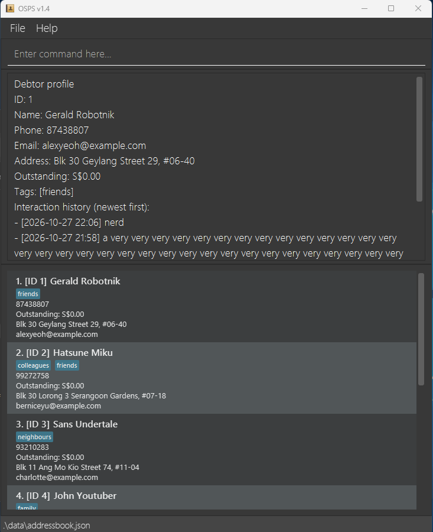
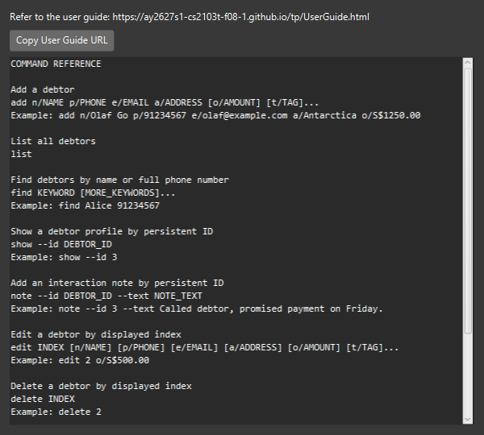
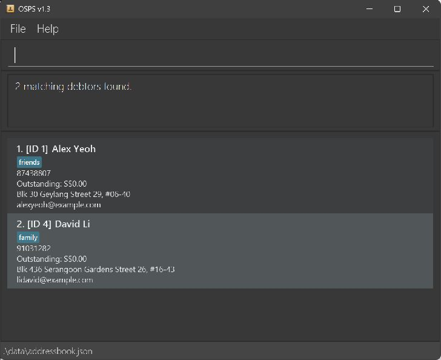

Orchestration and Scheduling of Payment Scheme (OSPS) v1.5 is a **desktop application for debt recovery agents**.
It manages debtor contact details, outstanding balances, and interaction histories through keyboard-driven commands
while retaining the benefits of a graphical user interface (GUI).

* Table of Contents
{:toc}

--------------------------------------------------------------------------------------------------------------------

## Quick start

1. Ensure that Java `25` or later is installed on your computer.<br>
   **Mac users:** Ensure you have the precise JDK version prescribed [here](https://se-education.org/guides/tutorials/javaInstallationMac.html).

1. Download `osps.jar` from the latest
   [OSPS release](https://github.com/AY2627S1-CS2103T-F08-1/tp/releases).

1. Copy the file to the folder you want to use as the _home folder_ for OSPS.

1. Open a terminal, `cd` to the folder containing the JAR file, and run `java -jar osps.jar`.<br>
   The OSPS window should appear in a few seconds with sample debtor data on a first run.

   

1. Type a command in the command box and press Enter to execute it. For example, type **`help`** and press Enter to open the help window.<br>
   Some example commands you can try:

   * `list` : Lists all active debtors.

   * `add n/Olaf Go p/91234567 e/olaf.letnonego@example.com a/H4M8+3J3, Kunlun Station, Antarctica o/S$1,250.00` : Adds a debtor named `Olaf Go` to OSPS.

   * `note --id 1 --outcome payment-promised --text Called debtor, promised payment on Friday.` : Adds an
     interaction note with a structured outcome to debtor ID 1.

   * `followup --id 1 --date 2026-11-03` : Schedules a follow-up for debtor ID 1.

   * `show --id 1` : Shows the complete profile and interaction history of debtor ID 1.

   * `delete 3` : Deletes the 3rd debtor shown in the current list.

   * `clear` : Deletes all debtor records.

   * `undo` : Reverses the most recent saved change in this session.

   * `redo` : Reapplies the most recently undone change in this session.

   * `exit` : Exits the app.

1. Refer to the [Features](#features) section below for details of each command.

--------------------------------------------------------------------------------------------------------------------

## Features

<div markdown="block" class="alert alert-info">

**:information_source: Notes about the command format:**<br>

* Words in `UPPER_CASE` are the parameters to be supplied by the user.<br>
  For example, in `add n/NAME`, replace `NAME` with a value such as `John Doe`.

* Items in square brackets are optional.<br>
  For example, `n/NAME [t/TAG]` can be used as `n/John Doe t/friend` or as `n/John Doe`.

* Items followed by `…`​ can appear zero or more times.<br>
  For example, `[t/TAG]…​` may be omitted, or written as `t/friend` or `t/friend t/family`.

* Parameters can be in any order.<br>
  For example, if the command specifies `n/NAME p/PHONE_NUMBER`, `p/PHONE_NUMBER n/NAME` is also acceptable.

* Extraneous parameters for commands that take no parameters, such as `help`, `exit`, and `clear`, are ignored.<br>
  For example, `help 123` is interpreted as `help`.

* The `list` command accepts no parameters. Unexpected parameters are rejected with an error message so that typing
  mistakes are not silently ignored.

* `undo` and `redo` also reject extra parameters. Their history lasts only until the app closes. A new saved change
  after `undo` clears the redo history. A change that fails to save is not applied and does not enter history.

* If you are using a PDF version of this document, be careful when copying and pasting commands that span multiple lines as space characters surrounding line-breaks may be omitted when copied over to the application.
</div>

### Choosing the correct debtor number

Each debtor card shows both a displayed index and a persistent debtor ID. In a heading such as `2. [ID 7] Alex Tan`,
`2` is the debtor's current displayed index while `7` is the debtor's persistent ID.

* Use the persistent ID with `show --id DEBTOR_ID` and
  `note --id DEBTOR_ID [--outcome OUTCOME] --text NOTE_TEXT`.
* Use the displayed index with `delete INDEX` and `edit INDEX ...`.
* A persistent ID stays with the same debtor until that debtor is deleted. A displayed index can change after a `find`,
  `list`, `add`, `edit`, or `delete` command.

### Viewing help: `help`

Opens a scrollable, keyboard-accessible in-app command reference. It includes the syntax and a short example for
each released command. The window also retains a button to copy the link to this online User Guide.



Format: `help`


### Adding a debtor: `add`

Adds a debtor to OSPS. The outstanding amount is optional, may be zero, and defaults to `S$0.00`.
Each debtor is assigned a unique ID, which is shown in the debtor list. New ID are assigned in increasing numerical order and are not reused after deletion or `clear`.

Format: `add n/NAME p/PHONE_NUMBER e/EMAIL a/ADDRESS [o/OUTSTANDING_AMOUNT] [t/TAG]…​`

<div markdown="span" class="alert alert-primary">:bulb: **Tip:**
A debtor can have any number of tags, including zero.
</div>

* `OUTSTANDING_AMOUNT` must be a non-negative number with at most two decimal places. An optional `S$` or `$` prefix
  and correctly grouped comma separators are accepted; for example, `0`, `S$0.00`, `$1250.5`, and `S$1,250.00`.
* Negative values, malformed currency, and values with more than two decimal places are rejected.
* Names must start and end with an alphanumeric character. Spaces, hyphens, and apostrophes are allowed within a
  name; for example, `Anne-Marie` and `O'Neil` are valid.
* Phone numbers and email addresses must be unique across active debtors. Debtors may share the same name.
* Leading and trailing spaces around command values are removed. Phone numbers accept digits only (at least
  three); spaces within a number, hyphens and `+` are rejected. Country codes and leading zeroes are not
  normalised, so `6591234567` and `91234567` are treated as different numbers.
* Email addresses accept ASCII Punycode domain labels such as `person@xn--bcher-kva.de`. Domain labels may
  contain consecutive internal hyphens but must start and end with letters or digits.
* Addresses must not be blank, including addresses containing only Unicode spaces.
* Email duplicate checks are case-sensitive: `Alice@example.com` and `alice@example.com` are treated as
  different addresses. Aliases such as `alice+work@example.com` are not matched to `alice@example.com`.
  Check existing records before adding a debtor under a different spelling of the same contact.
* Deleted IDs are not reused after saving and restarting, even when the last debtor is deleted.

Examples:
* `add n/Olaf Go p/91234567 e/olaf.letnonego@example.com a/H4M8+3J3, Kunlun Station, Antarctica o/S$1,250.00`
* `add n/John Doe p/98765432 e/johnd@example.com a/John street, block 123, #01-01`
* `add n/Betsy Crowe t/friend e/betsycrowe@example.com a/Newgate Prison p/1234567 t/criminal`

### Listing all debtors: `list`

Shows every active debtor in ascending debtor ID order. Each debtor card shows the ID, name, phone number,
outstanding amount, email address, address, and tags. The result reports the active-debtor count and displays
a helpful message when there are no active debtors. Running `list` also clears an active `find` filter and restores
the complete debtor list. The number before `[ID ...]` is the current displayed index; the value inside `[ID ...]`
is the debtor's persistent ID.

Format: `list`

The command does not accept any parameters.

Examples of result messages:
* `No active debtors found (0 active). Add a debtor with the add command.`
* `1 active debtor listed.`
* `5 active debtors listed.`

### Sorting the displayed debtor worklist: `sort`

Sorts the debtors currently shown in the list. It does not add, remove, or modify debtor records, and it does not
change which debtors an active `find` filter includes.

Format: `sort --by id|name|amount [--order asc|desc]`

* `--by` is required. Choose `id`, `name`, or `amount`.
* `--order` is optional and defaults to `asc`. Choose `asc` or `desc`.
* Field and order values are case-insensitive. Options may be written in either order, but each option may appear
  only once. Unknown options and extra values are rejected without changing the displayed list.
* Names are compared case-insensitively. Outstanding amounts are compared by their numeric value, not their
  formatted text.
* When two debtors have the same name or amount, the lower persistent debtor ID is shown first. This ID tie-breaker
  remains ascending even when the chosen field is descending.
* Sorting changes displayed indexes. A following `edit INDEX` or `delete INDEX` acts on the debtor shown at that
  index after sorting. Check the visible ID before running an index-based command.
* `sort` preserves the current filtered set. Running `find` starts a new filtered view in ascending ID order.
  Running `list` restores all active debtors in ascending ID order. A successful `add` also restores that normal
  list. Edit and delete keep the active filter and sort, and the list refreshes if a changed field affects its order.
* Sort settings last only for the current session and are not written to the data file.

Examples:
* `sort --by amount --order desc` shows the largest outstanding amount first.
* `find Alice` followed by `sort --by name` sorts only the matching debtors by name.
* `sort --order DESC --by ID` shows the highest persistent debtor ID first.

### Adding an interaction note: `note`

Adds a timestamped interaction note to the debtor identified by debtor ID.

Format: `note --id DEBTOR_ID [--outcome OUTCOME] --text NOTE_TEXT`

* `DEBTOR_ID` must be a positive integer shown as the debtor's ID in the debtor list.
* `OUTCOME` is optional and is case-insensitive. It must be one of `reached`, `callback-requested`, `unreachable`, or
  `payment-promised`. If omitted, the note is displayed with the outcome `unspecified`.
* `NOTE_TEXT` must not be blank. Ordinary punctuation is allowed, and there is no arbitrary note-length limit.
* `--outcome`, when used, must appear before `--text`. The `--id` and `--text` parameters can be provided in either
  order. Text after `--text`, including `--outcome`, is treated as note text unless it is a reserved `--id` or
  `--text` parameter.
* The tokens `--id` and `--text` are reserved for command parameters and cannot appear inside `NOTE_TEXT`.
  Other words beginning with `--`, such as `--identifier`, are kept as part of the note text after `--text`.
  Unknown options before `--text` or in the `--id` value are rejected.
* The note is saved with the debtor and is preserved after restarting the application.
* Repeating the same note records a separate interaction each time. Editing the debtor preserves all existing notes.
* Recording an outcome does not change the debtor's outstanding amount or any other debtor field.
* If saving fails, OSPS reports an error and does not add the note to the in-memory record or replace the saved file.
  Resolve the save problem, then run the note command again. The `exit` command does not retry a failed command.

Example:
* `note --id 1 --outcome reached --text Confirmed the debtor's identity.`
* `note --outcome callback-requested --id 1 --text Debtor requested a call tomorrow morning.`
* `note --id 1 --text Sent a written reminder.` records a note with an `unspecified` outcome.

### Scheduling a debtor follow-up: `followup`

Schedules or reschedules the next follow-up date, clears a pending date, or marks a pending follow-up complete.
Each change is timestamped in the debtor's follow-up history.

Formats:
* `followup --id DEBTOR_ID --date YYYY-MM-DD`
* `followup --id DEBTOR_ID --clear`
* `followup --id DEBTOR_ID --done`

* `DEBTOR_ID` must be a positive persistent debtor ID.
* Dates must be real calendar dates in exactly `YYYY-MM-DD` format, with years from `0001` through `9999`.
* Setting the current date again is a no-op and adds no history event.
* `--clear` and `--done` require a pending follow-up. Both clear the pending date and record the date that was cleared
  or completed in history.
* Scheduling a new date after `--clear` or `--done` starts a new `SCHEDULED` history event.
* Unknown, duplicate, or conflicting options are rejected without changing debtor data.
* Follow-up dates and history are preserved when the debtor is edited and after restarting the application. Legacy
  data without follow-up fields loads with no pending date and an empty history.
* If saving fails, the change is not applied to memory or disk. Resolve the storage problem and run the command again.

Examples:
* `followup --id 1 --date 2026-11-03`
* `followup --id 1 --date 2026-11-05` reschedules a pending date.
* `followup --id 1 --done` marks the pending follow-up complete.

### Updating recovery stage: `stage`

Sets the manual recovery stage of the debtor identified by persistent ID. Available stages are `new`, `contacted`,
`negotiating`, `disputed`, `broken-promise`, and `settled`. A settled debtor remains visible and retains its balance,
contact details, and history.

Format: `stage --id DEBTOR_ID --value STAGE`

Example: `stage --id 3 --value contacted`

### Summarising the workload: `summary`

Shows the current displayed workload's debtor count, outstanding total, zero-balance count, and stage counts. Use
`summary --all` to include every active debtor. The command does not change the displayed list or save data.

Formats: `summary` or `summary --all`

### Viewing a debtor profile: `show`

Shows the complete profile of the active debtor identified by persistent debtor ID. The profile includes the
debtor's name, phone number, email address, address, outstanding amount, tags, contact preferences, pending follow-up
date, interaction history, and follow-up history. Interaction notes are shown newest first, with each note's timestamp,
outcome, and text. Follow-up events are shown oldest first. If the debtor has no notes, the profile states that no
interaction notes are recorded.
If two notes have exactly the same timestamp, the later-added note is shown first; neither note is removed.
Displayed times have minute precision, so two notes showing the same time may have different stored timestamps.

Format: `show --id DEBTOR_ID`

* `DEBTOR_ID` must be a positive integer shown as the debtor's ID in the debtor list.
* Debtor IDs remain associated with the same debtor when the displayed list is filtered or reordered.
* A deleted debtor cannot be viewed. The command reports that no active debtor with that ID exists.
* The command accepts exactly one `--id` parameter. For example, `show 3` is not supported.

Example:
* `show --id 3` shows the complete profile of the active debtor with ID 3.

### Editing a debtor: `edit`

Edits an existing debtor in OSPS.

Format: `edit INDEX [n/NAME] [p/PHONE] [e/EMAIL] [a/ADDRESS] [o/OUTSTANDING_AMOUNT] [t/TAG]…​`

* Edits the debtor at the specified `INDEX`. The index refers to the index number shown in the displayed debtor list.
  The index **must be a positive integer** 1, 2, 3, …​
* At least one of the optional fields must be provided.
* Existing values will be updated to the input values.
* Updated names follow the same rules as names provided to `add`.
* Use `o/OUTSTANDING_AMOUNT` to replace the outstanding amount. It accepts the same non-negative currency values as
  `add`, such as `o/S$1,250.00` and `o/0`.
* Changing a phone number or email to one already used by another active debtor is rejected, including when
  that other debtor is hidden by a search. Phone numbers and email addresses use exact matching for uniqueness;
  country codes, leading zeroes, email case, and email aliases are not normalised.
* The persistent debtor ID and interaction notes are preserved.
* An active `find` filter remains applied after the edit. If an edited name no longer matches the active search,
  that debtor leaves the filtered results; run `list` to restore every active debtor.
* When editing tags, all of the debtor's existing tags are removed; adding tags is not cumulative.
* To remove all of a debtor's tags, enter `t/` without a tag after it.

Examples:
* `edit 1 p/91234567 e/johndoe@example.com` edits the phone number and email address of the 1st displayed debtor.
* `edit 2 n/Betsy Crower t/` edits the name of the 2nd displayed debtor and clears all existing tags.
* `edit 2 o/S$500.00` updates only the outstanding amount of the 2nd displayed debtor.

### Locating debtors by name or phone: `find`

Finds debtors using one or more name or phone search terms.

Format: `find KEYWORD [MORE_KEYWORDS]`

* The search is case-insensitive; for example, `hans` matches `Hans`.
* Keyword order does not matter; for example, `Hans Bo` matches `Bo Hans`.
* Name searches use literal substrings; for example, `Han` matches `Hans` and `lex` matches `Alex Yeoh`.
  Punctuation and symbols are matched as ordinary text rather than as regular expressions.
* A phone search must provide the complete phone number. For example, `91234567` matches that exact phone number,
  but `9123` does not match a phone number such as `91234567`. As every keyword also searches names, `9123` can
  still match a debtor whose name contains the literal substring `9123`.
* Debtors matching at least one name or phone keyword are returned (an `OR` search). For example,
  `Alice 98765432` returns debtors whose names contain `Alice` as a substring as well as the debtor whose phone is
  exactly `98765432`.
* Leading, trailing, and repeated whitespace is ignored. A blank search is rejected.
* Results are displayed in ascending persistent debtor ID order. If nothing matches, OSPS reports that no debtors
  matched the supplied name or phone keywords.
* Run `list` to clear the search filter and restore every active debtor.

Examples:
* `find Joh` returns `john` and `John Doe`.
* `find lex` returns names such as `Alex Yeoh` and `Alexandra Tan`.
* `find 91234567` returns the debtor whose phone number is exactly `91234567`.
* `find Alice 98765432` returns matches from either the name or phone search term.
* `find alex david` returns `Alex Yeoh`, `David Li`<br>
  

### Filtering debtors by outstanding amount: `list-amount`

Displays debtors whose outstanding amounts fall within an inclusive range. This is useful for focusing on high-value
accounts or a particular collection band without changing any debtor record.

Format: `list-amount [min/AMOUNT] [max/AMOUNT]`

* Provide at least one of `min/` and `max/`.
* Amounts use the same non-negative currency format as `add` and `edit`, including values such as `0`, `S$500.00`,
  and `2,000.00`.
* Bounds are inclusive: a balance equal to `min/` or `max/` is included.
* When both bounds are present, the minimum cannot exceed the maximum.
* Results replace an existing `find` or amount filter and appear in ascending persistent debtor-ID order.
* The displayed index refers to the filtered list. For example, `delete 1` acts on the first debtor currently shown.
* `list-amount` is read-only and does not change or save debtor data. Run `list` to restore every active debtor.

Examples:
* `list-amount min/1000` displays debtors owing at least `S$1,000.00`.
* `list-amount max/S$500.00` displays debtors owing at most `S$500.00`, including zero balances.
* `list-amount min/250 max/2,000.00` displays balances from `S$250.00` to `S$2,000.00`, inclusive.

### Deleting a debtor: `delete`

Deletes the specified debtor from OSPS.

Format: `delete INDEX`

* Leading zeros are accepted. Very large indexes are rejected with the displayed list's valid range;
  indexes longer than 100 significant digits are abbreviated in feedback. There is no input digit cap.

* Deletes the debtor at the specified `INDEX`.
* The index refers to the one-based position in the currently displayed debtor list, including `find` results.
* After deletion, the list refreshes and the current filter remains active.
* Deleting a debtor also removes that debtor's interaction notes. Other debtors keep their persistent IDs,
  outstanding amounts, and notes; their displayed indexes may change as the list closes the gap.
* The index **must be a positive integer** 1, 2, 3, …​
* For an index outside the displayed list, the error gives the displayed count and valid range. If no debtors are shown,
  run `list` or adjust the `find` query.

Examples:
* `list` followed by `delete 2` deletes the 2nd displayed debtor.
* `find Betsy` followed by `delete 1` deletes the 1st displayed debtor in the `find` results.

### Clearing all entries: `clear`

Clears all debtor records from OSPS. The clear can be reversed with `undo` during the current session.

The `clear` operation will be rejected if additional arguments are supplied

Format: `clear`

### Undoing and redoing changes: `undo`, `redo`

`undo` restores the previous successfully saved debtor data. `redo` reapplies an undone change. These commands cover
adds, edits, notes, deletes, and clears. The history is session-only and keeps at most 100 states, so you can undo up to 99 changes. Undoing or redoing
does not rewind the next debtor ID, so IDs are never reused. After every successful `undo` or `redo`, OSPS clears any
`find` filter and lists all debtors in ID order, so displayed indices refer to the full list.
After undo, a new saved change discards redo history. If a change, `undo` or `redo` cannot be saved, OSPS reports an
error and leaves your records, the undo and redo history, and the saved file exactly as they were. Resolve the problem
and run the command again. `exit` does not retry a failed command.

Format: `undo` or `redo`

### Exiting the program: `exit`

Exits the program.

Format: `exit`

### Saving the data

OSPS automatically saves data after every successful data-changing command. You do not need to save manually.

If a data-changing command cannot be saved, OSPS reports an error and leaves the in-memory records and existing data
file unchanged. Resolve the problem and re-enter that command. OSPS replaces the data file only when the file system
supports an atomic replacement; otherwise the save fails without overwriting the existing file.

### Editing the data file

OSPS data is saved as `data/addressbook.json` relative to the **current working folder** (the folder your terminal
is in when you launch OSPS). This can differ from the folder containing `osps.jar`. Always launch from the same
working folder to use the same records, including after upgrading the JAR. For example:

```bash
cd ~/Downloads/osps-data
java -jar ../osps.jar
```

Create `osps-data` first if it does not exist. In this example, records are saved to
`~/Downloads/osps-data/data/addressbook.json`; `preferences.json` is also in `osps-data`.
Launching from another folder uses a separate dataset. Advanced users may update data directly by editing that JSON file.

<div markdown="span" class="alert alert-warning">:exclamation: **Caution:**
If OSPS detects that the data file cannot be loaded, it starts with no debtor records. Some unsupported manual edits
may prevent startup; restore a backup if this happens. When OSPS starts with no debtor records after a loading error,
the invalid file remains on disk until you run a data-changing command. Back up the file before editing it.<br>
Furthermore, certain edits can cause OSPS to behave unexpectedly (for example, if a value is outside the accepted
range). Edit the data file only if you are confident that you can update it correctly.
Malformed JSON can also cause OSPS to fail to start.
</div>

## FAQ

**Q**: How do I transfer my data to another computer?<br>
**A**: Install OSPS on the other computer and overwrite the data file it creates with the `data/addressbook.json` file
from your previous OSPS working folder. Launch OSPS from the destination working folder each time.

--------------------------------------------------------------------------------------------------------------------

## Known issues

1. **When using multiple screens**, if you move the application to a secondary screen, and later switch to using only the primary screen, the GUI will open off-screen. The remedy is to delete the `preferences.json` file created by the application before running the application again.
2. **If you minimize the Help Window** and then run the `help` command (or use the `Help` menu, or the keyboard shortcut `F1`) again, the original Help Window will remain minimized, and no new Help Window will appear. The remedy is to manually restore the minimized Help Window.

--------------------------------------------------------------------------------------------------------------------

## Command summary

Action | Format, Examples
--------|------------------
**Add** | `add n/NAME p/PHONE_NUMBER e/EMAIL a/ADDRESS [o/OUTSTANDING_AMOUNT] [t/TAG]…​` <br> e.g., `add n/Olaf Go p/91234567 e/olaf.letnonego@example.com a/H4M8+3J3, Kunlun Station, Antarctica o/S$1,250.00`
**Clear** | `clear`
**Contact preferences** | `contact --id DEBTOR_ID [--method METHOD \| --clear-method] [--hours HH:mm-HH:mm \| --clear-hours]`
**Contactable** | `contactable [--at HH:mm] [--method call\|sms\|email\|letter]`<br> e.g., `contactable --at 09:30 --method sms`
**Export** | `export --id DEBTOR_ID`<br> e.g., `export --id 3`
**Preview** | `preview edit INDEX [FIELDS]` or `preview delete INDEX`<br> e.g., `preview delete 2`
**Delete** | `delete INDEX`<br> e.g., `delete 3`
**Edit** | `edit INDEX [n/NAME] [p/PHONE_NUMBER] [e/EMAIL] [a/ADDRESS] [o/OUTSTANDING_AMOUNT] [t/TAG]…​`<br> e.g., `edit 2 n/James Lee e/jameslee@example.com`
**Find** | `find KEYWORD [MORE_KEYWORDS]`<br> e.g., `find Alice 98765432`
**Filter by amount** | `list-amount [min/AMOUNT] [max/AMOUNT]`<br> e.g., `list-amount min/500 max/2,000`
**List** | `list`
**Note** | `note --id DEBTOR_ID [--outcome OUTCOME] --text NOTE_TEXT`<br> e.g., `note --id 1 --outcome reached --text Called debtor.`
**Follow-up** | `followup --id DEBTOR_ID --date YYYY-MM-DD` or `--clear` or `--done`<br> e.g., `followup --id 1 --date 2026-11-03`
**Undo** | `undo`
**Redo** | `redo`
**Show** | `show --id DEBTOR_ID`<br> e.g., `show --id 3`
**Stage** | `stage --id DEBTOR_ID --value STAGE`<br> e.g., `stage --id 3 --value contacted`
**Summary** | `summary` or `summary --all`
**Sort** | `sort --by id\|name\|amount [--order asc\|desc]`<br> e.g., `sort --by amount --order desc`
**Help** | `help`
**Exit** | `exit`

### Setting contact preferences: `contact`

Use `contact --id ID [--method METHOD | --clear-method] [--hours HH:mm-HH:mm | --clear-hours]` to update a debtor by persistent ID. Provide at least one change. Methods are `call`, `sms`, `email`, and `letter`. Hours are local, same-day, start-inclusive and end-exclusive, and the start must be before the end. The command records preferences; it does not contact the debtor.

Examples:

* `contact --id 3 --method sms --hours 09:00-17:30`
* `contact --id 3 --clear-method`
* `contact --id 3 --clear-hours`

Unchanged fields retain their previous values. Use `show --id 3` to see the preferences.

### Previewing an edit or deletion: `preview`

Use `preview edit INDEX [FIELDS]` or `preview delete INDEX` to see the result without changing or saving data. INDEX refers to the current displayed list, including filtering and sorting. Run the original command to apply it.

### Exporting a debtor profile: `export`

Use `export --id ID` to write the profile and interaction history as UTF-8 text to `exports/debtor-ID.txt` relative to the application working directory. An existing export is never overwritten; move or rename it before exporting the same ID again. The file contains sensitive debtor information, so share and store it carefully.

### Finding contactable debtors: `contactable`

Use `contactable [--at HH:mm] [--method call|sms|email|letter]` to find debtors with a configured contact window that includes the given local time. Omit `--at` to use the current local time. The start is included and the end is excluded. Debtors without hours are excluded; when a method is specified, only debtors with that explicit preference match. This is a scheduling aid, not a permission check, and does not contact anyone.

Example: `contactable --at 09:30 --method sms`. The command replaces the displayed list; use `list` to restore all debtors.
